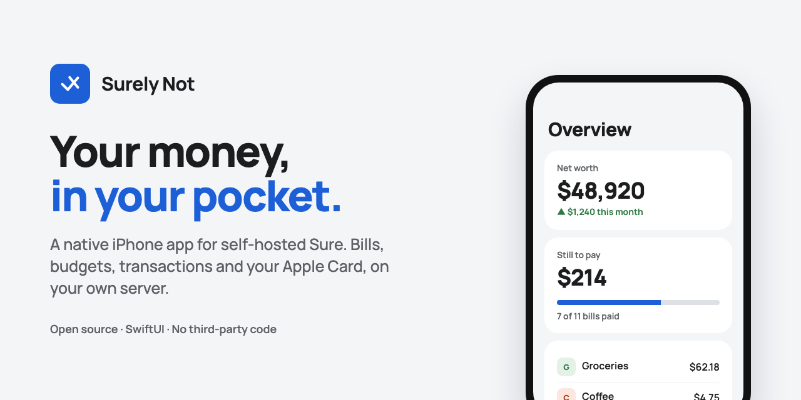

# Surely Not



**Your self-hosted money, in your pocket.** Surely Not is a native iPhone app for [Sure](https://github.com/we-promise/sure), the open source personal finance app you run on your own server.

- **Know what's left to pay.** Bills finds each repeating payment in your transactions, so "7 of 11 paid" is right even when Sure's own record lags.
- **Fix a category in one tap.** Tap a transaction's category, or press and hold the row, and move it.
- **Bring your Apple Card.** Apple Card, Apple Cash and Savings go from Wallet on your phone straight to your Sure server. Nothing passes through anyone else.
- **Glance, don't open.** Home and lock screen widgets show what's still due and how the month's budget is holding up, with amounts hidden while the phone is locked.

Built in SwiftUI with no third-party code. Your sign-in stays in the iOS Keychain and the app talks only to the server you give it.

This is a community project, not made by or affiliated with the Sure team.

## Status

Early, version 0.1. It builds and its unit tests pass, but it has not been released.

## What it does

Four tabs, each backed by Sure's REST API (`/api/v1`):

- **Overview**: net worth, this month's income and spending, spending compared with normal, the latest transactions, and insights. Tap a category to see the transactions behind it.
- **Bills**: this month's confirmed repeating payments, what is still to pay, and what has been paid. The app finds each payment in your transactions itself, because Sure's own record of the last payment can lag. Reached from Overview. Repeating payments Sure has only suggested can be tracked with one tap, and a tracked bill can be stopped.
- **Transactions**: every transaction across your accounts, with search and filters for period, type, account and category. Add one with the plus button. Move one to another category by tapping its category, or by pressing and holding its row. A list filtered to one category shows that category's last six months as a chart. Each one opens a detail screen with its notes, tags and links to everything else at that merchant, in that category or in that account.
- **Chat**: Sure's AI assistant. Start, rename and delete chats, send messages, retry failed replies.
- **Budgets**: each month's budget with spending per category. Tap a category to see that month's transactions in it.
- **Investments**: every position across your investment accounts, each one's share of the total, and how the total and each position have moved over the last 90 days. Reached from Accounts.
- **Widget**: a home screen and lock screen widget with what is still to pay this month, the next bills due, and spending against the month's budget. It shows what the app last loaded; iOS wakes the app in the background now and then to refresh it. Amounts are hidden while the phone is locked.
- **Bill reminders**: an optional notification at 9 in the morning the day before each bill, switched on in Settings. They are local to the phone and are dropped once a bill is paid.
- **Lock**: an optional Face ID, Touch ID or passcode lock, switched on in Settings. It asks on opening and after a minute away, and hides the figures in the app switcher.
- **Accounts**: accounts grouped by type, 90-day balance history, holdings, and transactions you can add, edit and delete.
- **Apple Wallet**: sends Apple Card, Apple Cash and Savings from Wallet on your phone to Sure, with balances and transactions. Reached from Accounts. See [Apple Wallet](#apple-wallet) for what it needs.

Enter your server address, then sign in the way that server allows: single sign-on (Pocket ID, Google and so on), email and password (with a two-factor code if you use one), or an API key. Sign-in details are stored only in the iOS Keychain.

### Known limits

These come from what Sure's API offers:

- Budgets and accounts are read-only, apart from accounts that Apple Wallet sync adds. Create and change the rest in Sure on the web.
- Apple Wallet sync has been run against one real Apple Card so far. Apple Card bill payments arrive in Sure as income, not as transfers.
- Chat replies are not streamed. The app checks for the reply every two seconds.
- Only the first 50 messages of a very long chat are shown.
- Single sign-on cannot link a new account or sign in an account that uses a two-factor code. Link the account in a browser first, or use email and password.
- Plain `http://` works only for servers on your local network. Anything else needs `https://`.

## Building

Requires Xcode 26 or later and iOS 26 or later. There are no third-party dependencies.

Open `SurelyNot.xcodeproj` and run the `SurelyNot` scheme.

### TestFlight

The app is in App Store Connect as "Surely Not" (app ID `6839306865`). `scripts/testflight.sh` archives a Release build, signs it for App Store Connect and uploads it. It needs Xcode signed in to the team and the `asc` CLI signed in with an App Store Connect API key. The build number is the current UTC time, so each upload is higher than the last. The "Internal Testers" group gets every build; external testers would need Apple's beta review first.

Whatever `Config/Local.xcconfig` says goes into the build, so on a Mac with Wallet sync on, TestFlight builds carry FinanceKit too.

### Apple Wallet

Apple has no server API for Apple Card. The only way to read it is on the phone, through Apple's FinanceKit. So the app reads Wallet and uploads what changed to Sure's Wallet API (`/api/v1/financekit`), which Sure already has.

What it needs:

- **Apple's permission.** FinanceKit only works in an app with the `com.apple.developer.financekit` entitlement, and stops the app dead if it is called without it. Apple grants the entitlement on request, per app; the Account Holder has to ask ([Get started with FinanceKit](https://developer.apple.com/financekit)). Apple granted it for `io.cronje.surelynot` on 25 November 2026, to an individual account, before the app was on the App Store. After the grant, tick FinanceKit on the App ID in Certificates, Identifiers & Profiles (FinanceKit Transaction Picker UI is not needed). Until Apple has granted it, leave Wallet sync off: a build signed with the entitlement before then will not install on a phone.
- **A real iPhone** in a country where Wallet shares account data: the United States for Apple Card, Apple Cash and Savings, and the United Kingdom for connected bank accounts. The Simulator has no Wallet data.
- **A current Sure server, reached over `https://`.** Wallet data is never sent over plain `http://`, not even on a local network.
- **A sign-in with a second step**, by an administrator of the household: email, password and a two-factor code, or single sign-on. A password alone or an API key will not do. Apple's FinanceKit terms ask for both of these, so the app holds itself to them.

To look at the Wallet screens in the Simulator, which has no Wallet data, run a Debug build with the launch argument `-WalletDemo setup` (the connect sheet) or `-WalletDemo connected` (a live connection). Both use a pretend Wallet and a pretend Sure, and are left out of Release builds.

To turn it on once Apple has granted the entitlement, create `Config/Local.xcconfig` (git ignores it) with:

```
WALLET_SYNC_ENABLED = YES
```

The entitlements follow from that line, so no `CODE_SIGN_ENTITLEMENTS` line is needed (an older one is ignored). Without the file the app builds and runs as before, and the Apple Wallet screen says the build has no permission.

#### Background sync

The app can also sync Wallet while it is closed. iOS 26 wakes a small extension in the app, `SurelyNotWalletSync`, when Wallet has something new, at most about once an hour, and the extension sends it to Sure the same way the app does. It is off until you turn it on, because it needs a second grant from Apple:

- **FinanceKit for the extension.** The extension has its own App ID, `io.cronje.surelynot.walletsync`, and Apple grants FinanceKit per App ID. Ask for it the same way as for the app, then tick FinanceKit on that App ID too. Until then leave background sync off: a build that embeds the extension signed with FinanceKit will not install.
- **The App Group `group.io.cronje.surelynot`** on both App IDs, so the app and the extension share the Wallet state. Register it under Identifiers and add it to both App IDs, or let Xcode's automatic signing do that the first time it signs a build with background sync on.

Then add a second line to `Config/Local.xcconfig`:

```
WALLET_SYNC_ENABLED = YES
WALLET_BACKGROUND_ENABLED = YES
```

With it off, the build is the same as before: the extension is compiled but not signed and not put in the app, the app's entitlements do not change, and the app never asks iOS for background delivery. The Wallet screen says "Background sync is off".

With it on:

- Once Wallet is connected, the app asks iOS to wake the extension for new accounts, balances and transactions, hourly at most. Disconnecting asks iOS to stop.
- The first launch moves the Wallet state (the connection, where each account's history was read up to, and any uploads still waiting) from the app's own folder into the shared one. It copies, checks the copy byte for byte, puts it in place in one step, then removes the original, so the live connection carries on where it was. If the move cannot finish, the app keeps using its own folder and tries again next launch.
- The app and the extension take a shared lock before touching the Wallet state, and read it afresh once they have it, so they never read Wallet or upload at the same time. A sync that finds the lock taken skips quietly; the other side has it covered.
- The extension holds to the same rules as the app: nothing is sent unless someone is signed in, with a second step, to a server on `https://`. It never asks for Wallet access and shows nothing.
- The extension uploads with the connection's upload key only, and never uses your sign-in, so it cannot sign you out by refreshing a token at the same moment as the app. Anything that needs the sign-in, such as a new upload key or a repair, waits for the app to open.
- The sign-in and the upload key stay where they are in the Keychain. The extension reads them from the app's own keychain group; the widget, which shares a different group, never sees them.

How it behaves:

- You pick the Wallet accounts in Apple's own sheet, then choose for each one whether Sure makes a new account or it goes into an existing account of the same kind and currency.
- It syncs when you open the app and when you tap Sync now, and with background sync on, while the app is closed.
- The first sync sends everything Wallet has, or only recent or new activity if you choose that. After that it sends only what changed, including transactions Wallet removed.
- Uploads are written to disk first and sent in order, so a lost connection loses nothing and nothing is sent twice.
- Sure does not overwrite a transaction you edited in Sure. It holds the change back and the app lists it under "needs a look".
- If Sure and the phone fall out of step, the app says so and offers a repair, which sends Wallet again in full. Sure matches what it already has.
- Disconnecting keeps what was imported, or removes it if you ask.

The code is in `SurelyNot/Wallet`, and the extension's entry point in `SurelyNotWalletSync`. `FinanceKitSource.swift` and the extension's `WalletSyncExtension.swift` are the only files that touch FinanceKit; the rest is tested against a pretend Wallet and a pretend Sure in `SurelyNotTests/WalletTests.swift` and `SurelyNotTests/WalletBackgroundTests.swift`.

### Design

The look is defined in `SurelyNot/Support/Theme.swift` and the shared pieces in `SurelyNot/Support/Components.swift`. The rules: colour belongs on data, not on buttons and bars; one blue marks the main thing a screen is about; categories and institutions get a pale tint of their own colour; surfaces are flat with one large corner radius; red is kept for what is over or wrong.

The typeface is [Manrope](https://github.com/sharanda/manrope), bundled in `SurelyNot/Fonts` under the SIL Open Font License (see `OFL.txt` there).

The project file is generated from `project.yml` with [XcodeGen](https://github.com/yonaskolb/XcodeGen). After adding, removing or moving files, run `xcodegen generate` and commit the result.

## Disclaimer

This project is not affiliated with, endorsed by, or sponsored by the Sure project, its maintainers, or Maybe Finance. "Sure" and "Maybe" are names of their respective owners and are used here only to describe what this client connects to.

## Licence

Licensed under the [MIT License](LICENSE).

Sure itself is licensed under AGPL-3.0. This client contains no Sure code or assets; it only talks to a Sure server through its API.
